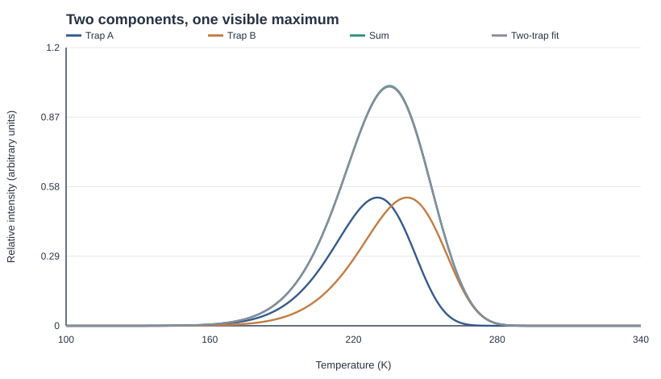

# When Two Traps Look Like One

**A computational investigation of defect-state resolution in semiconductors.**

Two trap levels do not necessarily produce two peaks. This project studies how distinct thermally activated defect states can collapse into a single apparent peak in a thermally stimulated conductivity (TSC) spectrum, and how much can actually be recovered from that spectrum.

The reference material is beta-In2S3, drawing on published TSC measurements by Pai et al. The spectra analyzed here are **synthetic**; the program does not fit or claim to reproduce the original experimental current traces.



## The problem

A TSC spectrum is often read in terms of trap activation energies. But a visible maximum is not a one-to-one map to a microscopic defect. Two traps may overlap, noise may obscure their separation, and an incomplete transport model may manufacture an apparently convincing extra component.

The code tests three related questions:

1. Can two distinct traps produce one visible maximum?
2. Can a one-trap/two-trap fit distinguish them and recover their energies?
3. Can missing background or temperature-dependent transport create a false second trap?

## Model

The baseline uses independent, first-order thermal emission:

$$
e_i(T) = s_i\exp\left(-\frac{E_i}{k_B T}\right),
\qquad
\frac{dn_{t,i}}{dt} = -e_i(T)n_{t,i}.
$$

With linear heating, $T(t)=T_0+\beta t$, and negligible retrapping, the total release flux is

$$
F(T) = \sum_i e_i(T)n_{t,i}(T).
$$

The synthetic TSC signal is taken to be proportional to this flux under an approximately constant collection/transport factor. It is **not** a full current-transport model: mobility, recombination, retrapping and contact effects can change the measured response.

The heating rate is set to 0.05 K/s, matching the published beta-In2S3 TSC protocol. The emission prefactor is calibrated from a reference peak and held fixed during the main inverse problem. That makes the results **conditional resolution tests**, not instrument-independent limits.

## Results

The baseline example combines **0.260 eV** and **0.275 eV** trap levels. Its total curve has one maximum near **235 K**, yet the two-trap fit recovers **0.26024 eV** and **0.27534 eV**. A one-trap fit instead returns an effective energy of **0.26748 eV**.

In a scan with 200 noise realizations per separation:

| Separation | Two-trap model preferred | Both energies recovered |
| ---: | ---: | ---: |
| 2 meV | 0 / 200 | 0 / 200 |
| 5 meV | 138 / 200 | 67 / 200 |
| 10 meV | 200 / 200 | 199 / 200 |
| 15 meV | 200 / 200 | 200 / 200 |
| 20 meV | 200 / 200 | 200 / 200 |

Model preference uses $\Delta\mathrm{BIC}>10$. Energy recovery additionally requires both fitted energies to lie within **2 meV** of their generating values.

The stress tests are equally important: when a one-trap spectrum contains an unmodeled constant background or a synthetic temperature-dependent weighting, a restricted two-trap fit is incorrectly preferred in **200 / 200** trials for each case. A better fit is not, on its own, evidence of a second physical defect.

All counts above are tied to `configs/experiment.json`, the supplied random seed, and the implemented optimization procedure. See `results/` for the underlying JSON/CSV files.

## Run it

Requires **Go 1.23+**. The numerical code uses the Go standard library only.

```sh
go test ./...
go run ./cmd/traplab demo configs/experiment.json
go run ./cmd/traplab scan configs/experiment.json 200
go run ./cmd/traplab stress configs/experiment.json 200
```

To regenerate every numerical result:

```sh
make data
```

To rebuild the figures and accompanying IEEE-format paper, install **Inkscape** and **pdflatex**, then run:

```sh
make all
```

The generated data and SVG figures are written to `results/`. The manuscript is in [`paper/root.tex`](paper/root.tex), with a compiled copy at [`paper/root.pdf`](paper/root.pdf).

## Repository layout

```text
cmd/traplab/        Experiment runner
cmd/paperdata/      Results exported to LaTeX
internal/tsc/      Kinetics, fitting, experiments, plotting, tests
configs/           Protocol and deterministic seed
results/           Spectra, fit outputs, scan data and SVG plots
paper/             IEEE manuscript, figures and generated numbers
docs/              Sources, scientific audit and research notes
```

## What this does not establish

- A recovered activation energy is not a chemical identification of a defect.
- The second level in the baseline experiment (0.275 eV) is hypothetical.
- The effective emission prefactor is calibrated, not measured independently.
- The first-order model omits retrapping and explicit carrier-lifetime kinetics.
- The reported resolution depends on the noise model, temperature grid, candidate models and fixed parameters.

The broader problem is **identifiability**: whether distinct physical mechanisms can produce responses too similar to separate from the available measurements.

## References

- R. R. Pai et al., *Defect characterization of spray pyrolised beta-In2S3 thin film using Thermally Stimulated Current measurements*, Journal of Materials Science **40**, 741-746 (2005). [DOI](https://doi.org/10.1007/s10853-005-6315-8)
- G. A. Dussel and R. H. Bube, *Theory of Thermally Stimulated Conductivity in a Previously Photoexcited Crystal*, Physical Review **155**, 764-779 (1967). [DOI](https://doi.org/10.1103/PhysRev.155.764)
- P. Pistor et al., *Structure reinvestigation of alpha-, beta- and gamma-In2S3*, Acta Crystallographica B **72**, 410-415 (2016). [DOI](https://doi.org/10.1107/S2052520616007058)

The full bibliography and discussion of beta-In2S3 band structure are in [`paper/root.tex`](paper/root.tex).
